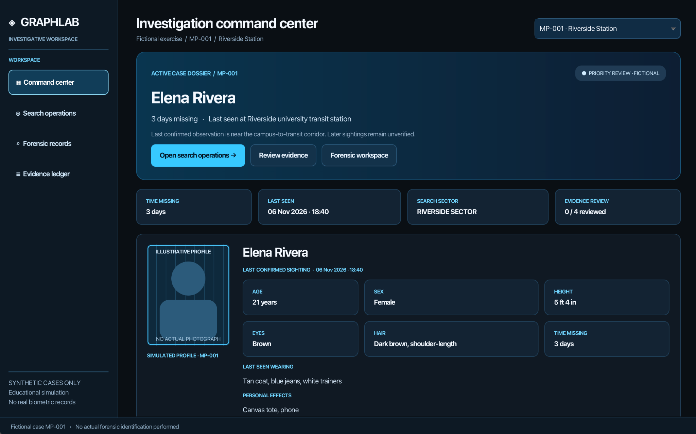
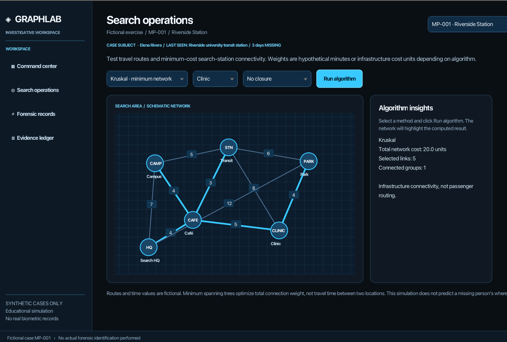
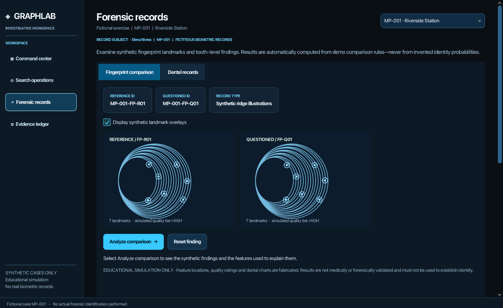

# GraphLab — Search Intelligence

**Interactive fictional missing-person search & evidence simulation** — Java / JavaFX / Maven.

## Application Screenshots

## Launch in IntelliJ IDEA

1. Extract the ZIP and open the **GraphLab_SearchIntelligence** folder as a project.
2. Wait for Maven to load the JavaFX dependencies; choose JDK 23 (or another compatible JDK).
3. Open `src/main/java/com/graphlab/GraphLabLauncher.java` and click the green Run button beside `main()`.
4. If JavaFX dependencies do not resolve, use the Maven tool window to reload the project. You can alternatively run the `exec:java` Maven goal.

Do **not** run `GraphLabDemo` if you want to see the window; that is the original console-based demonstration. The `GraphLabLauncher` class is the normal one-click entry point.

## Features

- **Command Center:** fictional case profiles with name, age, sex, physical description, last confirmed sighting, clothing, belongings, distinguishing features, case note, and time missing (relative to the **fixed fictional reference date of November 9, 2026**).
- **Investigation Simulation:** Play, Pause, Next event and Reset buttons advance four explicitly simulated events, with a progress indicator and changing activity feed. Different cases retain their own local simulation progress during the session.
- **Search Operations:** original interactive route network, selectable edge closure, Dijkstra shortest-path, BFS connectivity exploration, Prim and Kruskal MST analysis.
- **Forensic Records:** synthetic fingerprint landmark overlay and rule-based dental comparison with identification, exclusion, inconclusive and unsuitable exercises.
- **Evidence Ledger:** searchable fictional evidence records and local review checkboxes.
- **Visual Design:** matte graphite `#0B0F14`, panel `#121922`, icy blue `#67C6FF`, white `#F5F9FF`, restrained blue highlights.

## Algorithms & Practical Applications

GraphLab uses a **weighted, undirected graph** to represent a fictional search area. **Vertices** represent locations (campus, transit station, park, café, clinic, and search headquarters), and **edges** represent possible connections. A selectable route closure removes an edge from consideration for that run. These algorithms support *search logistics and network analysis*; they do not infer a missing person’s location.

### Dijkstra's algorithm — minimum-travel-time route

**Why it matters:** Search teams often need to compare travel routes between known locations. Dijkstra's algorithm finds a path with the **minimum sum of nonnegative edge weights** from one source to a destination.

**In GraphLab:** The simulation starts at **Campus (CAMP)** and lets users choose a destination, such as **Clinic**. The algorithm uses hypothetical travel-time weights, respects a selected closed connection, and highlights the resulting path. If the destination becomes unreachable, it reports no route.

**How it's implemented:** `SearchNetwork.dijkstra(...)` maintains tentative distances, predecessor links, and a Java `PriorityQueue` to explore lower-cost candidates first. A predecessor chain reconstructs the final path. With the current implementation's edge-list scan for each visited vertex, a conservative upper bound is **O(VE + E log E)**; an adjacency-list implementation would improve typical performance to **O((V + E) log V)**.

### Breadth-First Search (BFS) — reachable-location exploration

**Why it matters:** BFS identifies which sites can be reached from a starting location, even when some connections are unavailable. It can also support minimum-hop routing in *unweighted* networks, although this project uses it to show exploration order, not a travel-time-optimized route.

**In GraphLab:** Starting at **Campus**, BFS produces and displays the order in which locations are explored while excluding the selected closed edge. Teams can see the extent of the reachable network.

**How it's implemented:** `SearchNetwork.bfs(...)` uses an `ArrayDeque` queue and a `HashSet` of discovered locations. In this implementation, adjacent connections are found by scanning the graph's edge list for each visited vertex, giving **O(VE)** time in the worst case. A dedicated adjacency-list representation would support **O(V + E)** traversal.

### Kruskal's algorithm — minimum-cost search network

**Why it matters:** When the task is to connect multiple search coordination sites with the smallest **total infrastructure cost**, a minimum spanning tree (MST) is an appropriate baseline. It optimizes the sum of selected connection weights—not the fastest route between any two sites.

**In GraphLab:** Kruskal's algorithm sorts available candidate connections by weight and selects each connection only if it joins two previously disconnected groups. The resulting network is highlighted, with its total cost, selected links, and number of connected groups shown in the insights panel.

**How it's implemented:** `KruskalMST.compute(...)` sorts `Edge` objects and uses `UnionFind` to detect cycles efficiently through **path compression** and **union by rank**. The overall time complexity is **O(E log E)** for sorting, plus near-constant amortized disjoint-set operations.

### Prim's algorithm — incremental minimum-cost connectivity

**Why it matters:** Prim's algorithm offers another way to find an MST, making it useful for comparing alternative algorithmic strategies on the same infrastructure-planning problem.

**In GraphLab:** Prim's algorithm grows a connected network by repeatedly choosing the cheapest eligible edge at its frontier. The app displays the final network and its total cost; on a connected graph, both Prim and Kruskal should yield the **same minimum total weight**, though the chosen edges may differ when weights tie.

**How it's implemented:** `PrimMST.compute(...)` uses a minimum-priority queue and a set of visited vertices, starting a new tree when necessary to handle disconnected input. It returns a **minimum spanning forest** when the available graph is disconnected. The binary-heap implementation has **O(E log E)** time complexity.

### How the algorithms differ

| Question in the simulation | Algorithm | Output |
|---|---|---|
| What is the fastest modeled route from Campus to a selected location? | **Dijkstra** | Minimum-total-weight path |
| Which locations remain reachable after a connection closes? | **BFS** | Reachable sites and exploration order |
| How can all search stations be connected with minimum total construction cost? | **Kruskal** | MST / minimum spanning forest |
| Can we obtain the same minimum network cost using a different strategy? | **Prim** | MST / minimum spanning forest |

**Practical limitation:** A minimum spanning tree has no redundant connections: losing any selected edge disconnects that tree. Real search operations may prioritize redundancy, access restrictions, team availability, safety, or changing conditions over minimum cost. GraphLab deliberately separates route-finding from network-design goals.

**Core classes:** [`SearchNetwork.java`](src/main/java/com/graphlab/search/SearchNetwork.java), [`KruskalMST.java`](src/main/java/com/graphlab/algorithms/KruskalMST.java), [`PrimMST.java`](src/main/java/com/graphlab/algorithms/PrimMST.java), and [`UnionFind.java`](src/main/java/com/graphlab/algorithms/UnionFind.java).

## Scope and data handling

All names, cases, physical descriptions, times, results, route costs and biometric illustrations are fabricated and for educational use. Profile portraits are clearly marked silhouettes, not photographs. No external data access, personal-data collection or actual forensic examination is provided. The simulated findings **must not be used to identify a real person**. Route algorithms describe hypothetical navigation or infrastructure costs, not predictions of a missing person's location.

## Code organization

- `com.graphlab.algorithms`: Prim, Kruskal, Union-Find.
- `com.graphlab.model`: Graph, Vertex, Edge.
- `com.graphlab.search`: Dijkstra, BFS and example search network.
- `com.graphlab.forensics`: fabricated cases and comparison teaching rules.
- `com.graphlab.ui`: JavaFX dashboard, evidence views, profiles, animation.
- `src/main/resources/styles/search.css`: modern slate / ice-blue theme.

## Validation

The Java 21 non-UI source compiles and the original GraphLab demo executes successfully. The JavaFX GUI could not be compiled/run in the build environment because JavaFX/Maven runtime dependencies are unavailable here. Verify the user interface and the included JUnit tests after Maven downloads dependencies on your computer.
